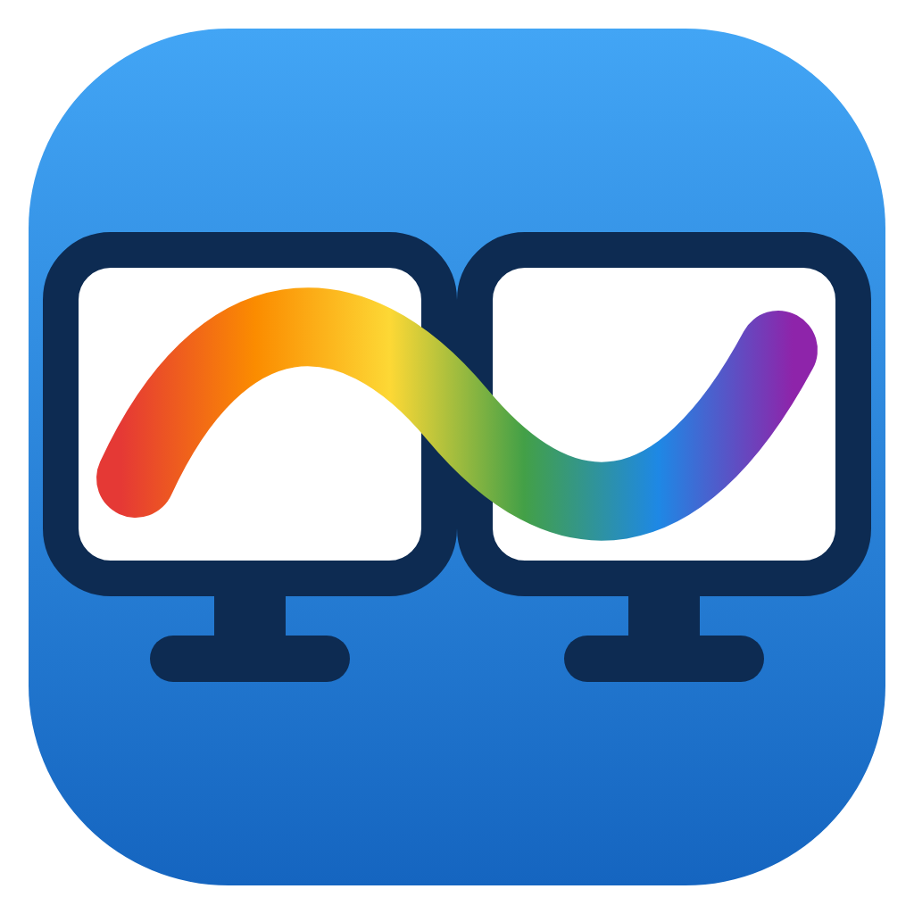
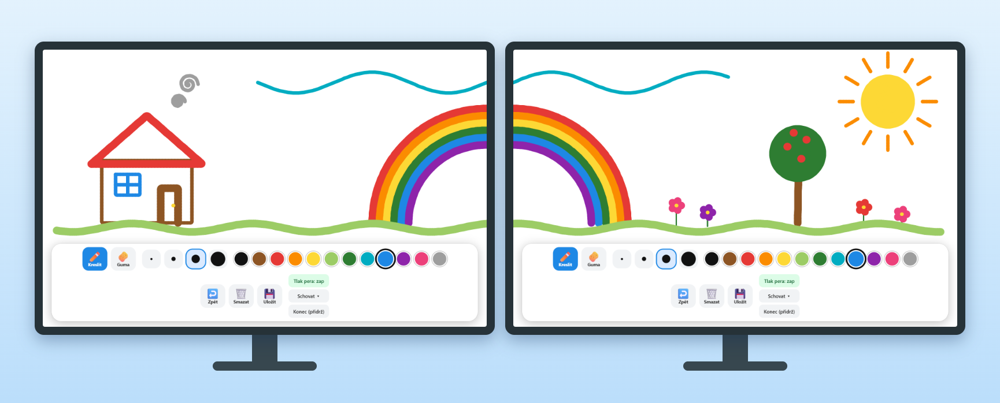

<p align="center">
  
</p>

<h1 align="center">Multi-Monitor Canvas</h1>

<p align="center">
  Jednoduché kreslení pro děti: <b>jedno velké plátno přes všechny monitory</b>.<br>
  Tah perem vedeš plynule z jednoho monitoru na druhý.
</p>

<p align="center">
  <a href="README.md">🇬🇧 English</a>
</p>

<p align="center">
  
</p>

> [!NOTE]
> **Beta (0.1.x).** Automaticky ověřeno na Windows a Linuxu se dvěma simulovanými monitory a myší.
> Na skutečném Windows s tabletem, tlakem pera a více fyzickými monitory to ještě **nebylo všude vyzkoušené**,
> podpora macOS je **experimentální**. Budeme rádi za
> [hlášení, jak to funguje na tvém hardwaru](https://github.com/HonzaVrkota/multi-monitor-canvas/issues/new?template=hardware_report.yml).

## Co umí

- 🖥️🖥️ **Jedno sdílené plátno přes všechny monitory.** Na každém monitoru je okno přes celou obrazovku a tahy
  plynule přecházejí mezi nimi.
- ✏️ **Grafický tablet:** citlivost na tlak (Windows Ink / Pointer Events), konec pera (guma) gumuje automaticky.
- 🎨 12 barev, 4 tloušťky, guma, kroužek kolem kurzoru ukazuje velikost štětce.
- ↩️ Zpět (`Ctrl+Z`) a **Smazat vše** s potvrzením druhým klepnutím.
- 💾 Uloží **celé plátno** (všechny monitory) jako jedno PNG do `Obrázky\Kresleni`.
- 🧒 **Odolné vůči dětem:** panel na každém monitoru (dá se schovat), bez rámečků oken, bez zoomu, ukončení jen
  **podržením** tlačítka nebo `Ctrl+Shift+Q`.
- 🔌 Připojení/odpojení monitoru za běhu okna přestaví, kresba zůstane.
- 🔒 Úplně offline: žádná síť, žádná telemetrie, žádné účty.

## Stažení

Nejnovější verze je v [**Releases**](https://github.com/HonzaVrkota/multi-monitor-canvas/releases/latest):

| Systém                            | Soubor                                                  | Poznámka                                     |
| --------------------------------- | ------------------------------------------------------- | -------------------------------------------- |
| Windows 10/11 (x64)               | `multi-monitor-canvas-Setup-x.y.z.exe`                  | Instalátor (nabídka Start, odinstalace)      |
| Windows 10/11 (x64)               | `multi-monitor-canvas-x.y.z-portable.exe`               | Jeden soubor bez instalace, stačí zkopírovat |
| macOS 11+ (Intel i Apple Silicon) | `multi-monitor-canvas-x.y.z-mac-universal.dmg` / `.zip` | Experimentální, nepodepsané                  |
| Linux (x64, X11)                  | `multi-monitor-canvas-x.y.z-x86_64.AppImage`            | `chmod +x` a spustit                         |

### Bezpečnostní varování při prvním spuštění

Buildy **nejsou digitálně podepsané** (certifikáty stojí peníze a jde o volnočasový projekt), takže systém poprvé
varuje:

- **Windows (SmartScreen):** klikni na **Další informace → Přesto spustit**.
- **macOS 15+ (Gatekeeper):** aplikaci jednou otevři, pak **Nastavení systému → Soukromí a zabezpečení**, sjeď dolů
  a klikni na **Přesto otevřít**. Nebo v Terminálu:
  ```sh
  xattr -dr com.apple.quarantine "/Applications/Multi-Monitor Canvas.app"
  ```
- **Linux:** `chmod +x multi-monitor-canvas-*.AppImage` a spustit.

Stahuj jen ze stránky Releases tohoto repozitáře.

## Nastavení grafického tabletu (důležité)

Aby šlo kreslit přes všechny monitory, musí být tablet namapovaný na **celou plochu** (všechny monitory),
ne jen na jeden:

- **Wacom (Windows):** Vlastnosti tabletu Wacom → Mapování → **Celá plocha / All displays** (volbu „Zachovat
  proporce“ případně vypnout, ať se kruh nekreslí jako elipsa).
- **Wacom (macOS):** Wacom Center → tablet → Mapování → **All Displays**.
- **Huion / XP-Pen / ostatní:** stejná volba v ovladači (_All screens_ / _Full desktop_).

Pro **citlivost na tlak** na Windows musí být v ovladači zapnuté **Windows Ink**. Bez něj pero funguje jako myš
(konstantní tloušťka). V aplikaci jde tlak vypnout tlačítkem _Tlak pera_.

## Ovládání

| Ovládací prvek       | Co dělá                                                                       |
| -------------------- | ----------------------------------------------------------------------------- |
| ✏️ Kreslit / 🧽 Guma | přepíná kreslení a gumování                                                   |
| 4 tečky              | tloušťka čáry (tenká → tlustá)                                                |
| barevná kolečka      | barva (výběr barvy vrátí z gumy zpět na kreslení)                             |
| ↩️ Zpět              | vrátí poslední tah (také `Ctrl+Z` / `Cmd+Z`)                                  |
| 🗑️ Smazat            | smaže vše, chce **druhé klepnutí** (tlačítko zčervená „Opravdu?“)             |
| 💾 Uložit            | uloží celé plátno jako PNG do `Obrázky\Kresleni`                              |
| Tlak pera            | zapne/vypne citlivost na tlak                                                 |
| Schovat ▾            | schová panel na tomto monitoru (zpátky přes 🎨)                               |
| Konec (přidrž)       | ukončí aplikaci po **podržení cca 1 s** (nebo `Ctrl+Shift+Q` / `Cmd+Shift+Q`) |

Panel je na každém monitoru, takže barvu lze změnit kdekoli; nastavení je sdílené.

## Poznámky k macOS (experimentální)

Podpora macOS je zrevidovaná v kódu a běží v CI, ale **na skutečném Macu zatím nebyla vyzkoušená**.

- Každý monitor má vlastní okno v režimu „simple fullscreen“ nad menu barem a Dockem. Funguje se zapnutým
  i vypnutým **Monitory mají samostatné plochy** (_Displays have separate Spaces_) (Nastavení systému → Plocha a Dock → Mission Control).
- Gesta Mission Control / App Exposé můžou na chvíli ukázat jiná okna – u malých dětí je případně vypni.
- Obyčejné `Cmd+Q` je **schválně vypnuté**, aby děti aplikaci omylem nezavřely. Ukončení: `Cmd+Shift+Q`, podržení
  tlačítka **Konec**, nebo pravým na ikonu v Docku → **Ukončit**.

## Jak to funguje

- Hlavní proces (`main.js`) otevře okno bez rámečku na každém monitoru a drží sdílenou kresbu.
- Tahy se ukládají v **globálních souřadnicích plochy**; každé okno vykreslí jen svůj výřez.
- Při tažení se ukazatel „zachytí“ v okně, kde tah začal, takže události chodí i za jeho hranici a tah se
  průběžně objevuje i na sousedním monitoru.
- Připojení/odpojení monitoru za běhu okna přestaví, kresba zůstane.
- Bezpečnost: `contextIsolation`, `sandbox`, bez `nodeIntegration`, přísná CSP, whitelist IPC kanálů a validace
  všech zpráv v hlavním procesu; navigace a nová okna jsou zablokované.

## Vývoj

Potřebuješ **Node.js 20+**.

```sh
git clone https://github.com/HonzaVrkota/multi-monitor-canvas.git
cd multi-monitor-canvas
npm install
npm start
```

Na Windows stačí dvojklik na `spustit.bat` (při prvním spuštění sám nainstaluje závislosti).

`npm test` spustí aplikaci se **dvěma simulovanými monitory**, nakreslí tah přes jejich hranici a ověří vykreslení
v obou oknech, zpět, gumu, uložení PNG a smazání (na Linuxu bez displeje:
`xvfb-run -a npx electron --no-sandbox test/smoke-main.js`). Další příkazy (`lint`, `format`, `dist:*`, `icons`,
`screenshot`) a postup vydání najdeš v [anglickém README](README.md#development) a v [CONTRIBUTING.md](CONTRIBUTING.md).

## Plány

Viz [Roadmap v anglickém README](README.md#roadmap) a [issues](https://github.com/HonzaVrkota/multi-monitor-canvas/issues):
automatické ukládání, redo, anglické UI, rodičovský zámek, omalovánky, kbelík, galerie, výběr monitorů a další.

## Známá omezení

- Monitory s **různým škálováním** (např. 100 % a 150 %) můžou mít na přechodu drobný posun. Nejjistější je
  nastavit ve Windows stejné škálování na všech monitorech.
- Na Linuxu je potřeba **X11** (ne čisté Wayland).
- Kresba žije **jen v paměti** běžící aplikace – po ukončení se ztratí, pokud ji neuložíš (💾).

## Licence

[MIT](LICENSE) © 2026 Honza Vrkota
