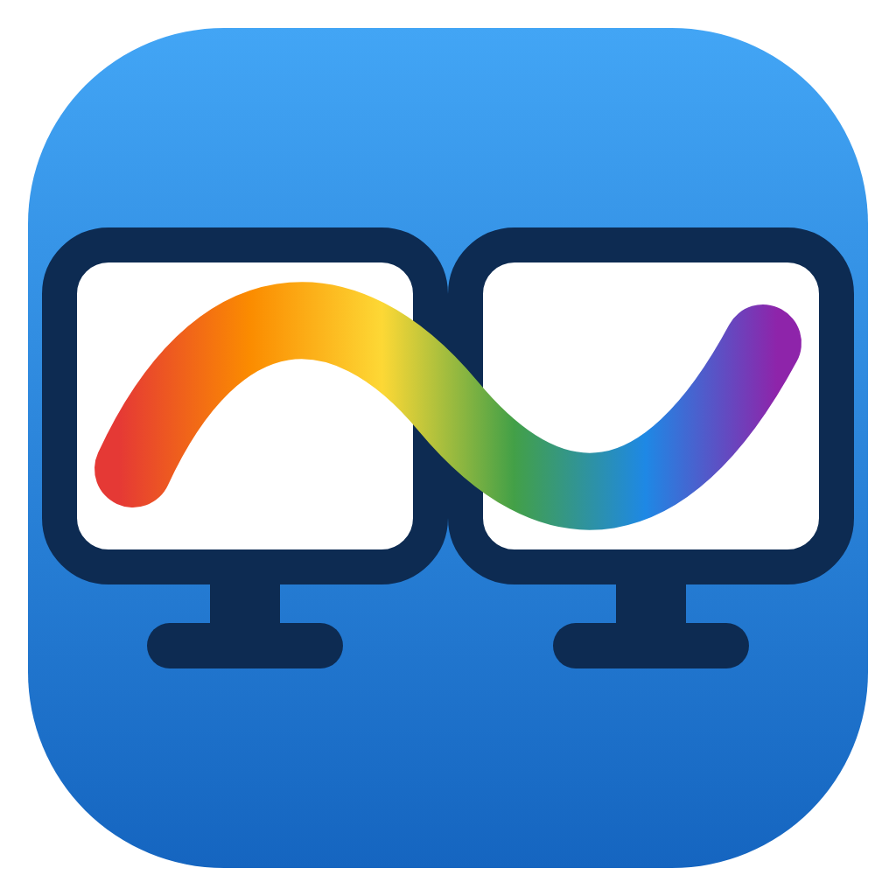
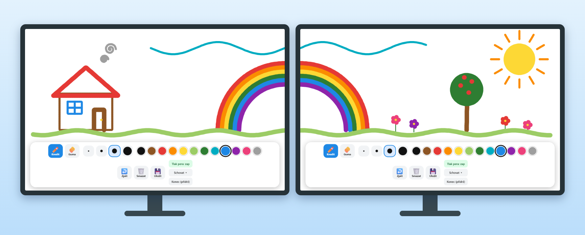

<p align="center">
  
</p>

<h1 align="center">Multi-Monitor Canvas</h1>

<p align="center">
  A simple drawing app for kids: <b>one big canvas spanning all your monitors</b>.<br>
  Draw a single stroke from one screen straight onto the next.
</p>

<p align="center">
  <a href="https://github.com/HonzaVrkota/multi-monitor-canvas/actions/workflows/ci.yml"></a>
  <a href="https://github.com/HonzaVrkota/multi-monitor-canvas/releases/latest"></a>
  <a href="LICENSE"></a>
  
</p>

<p align="center">
  <a href="README.cs.md">🇨🇿 Česky</a>
</p>

<p align="center">
  
</p>

> [!NOTE]
> **Beta (0.1.x).** Verified automatically on Windows and Linux with two simulated monitors and mouse input.
> It has **not yet been tried on every real setup** with a pen tablet, pressure and several physical monitors.
> macOS support is **experimental**. Please
> [report how it works on your hardware](https://github.com/HonzaVrkota/multi-monitor-canvas/issues/new?template=hardware_report.yml),
> because that helps more than anything else.

## Features

- 🖥️🖥️ **One shared canvas across all monitors.** Every display gets a borderless fullscreen window, and strokes flow seamlessly between them.
- ✏️ **Pen tablet friendly:** pressure sensitivity (Windows Ink / Pointer Events), and the pen's eraser tip erases automatically.
- 🎨 12 kid-friendly colours, 4 brush sizes, eraser, and a ring cursor that shows the brush size.
- ↩️ Undo (`Ctrl+Z`) and **Clear all** that needs a second tap to confirm, so nothing gets wiped by accident.
- 💾 Saves the **whole canvas** (all monitors) as one PNG into `Pictures/Kresleni`.
- 🧒 **Kid-proof:** a toolbar on every monitor that can be hidden, no window chrome, zoom blocked, and quitting needs a **long press** or `Ctrl+Shift+Q`.
- 🔌 Plugging in or unplugging a monitor while the app runs rebuilds the windows and keeps the drawing.
- 🔒 Fully offline: no network access, no telemetry, no accounts.

## Download

Get the latest build from [**Releases**](https://github.com/HonzaVrkota/multi-monitor-canvas/releases/latest):

| OS                                | File                                                    | Notes                                  |
| --------------------------------- | ------------------------------------------------------- | -------------------------------------- |
| Windows 10/11 (x64)               | `multi-monitor-canvas-Setup-x.y.z.exe`                  | Installer (Start menu, uninstaller)    |
| Windows 10/11 (x64)               | `multi-monitor-canvas-x.y.z-portable.exe`               | Single file, no install. Copy and run. |
| macOS 11+ (Intel & Apple Silicon) | `multi-monitor-canvas-x.y.z-mac-universal.dmg` / `.zip` | Experimental, unsigned (see below)     |
| Linux (x64, X11)                  | `multi-monitor-canvas-x.y.z-x86_64.AppImage`            | `chmod +x` and run                     |

### The first launch shows a security warning

The builds are **not code-signed**, because signing certificates cost money and this is a free hobby project.
The operating system will warn you the first time:

- **Windows (SmartScreen):** click **More info → Run anyway**.
- **macOS 15+ (Gatekeeper):** open the app once, then go to **System Settings → Privacy & Security**, scroll down and
  click **Open Anyway**. Alternatively, in Terminal:
  ```sh
  xattr -dr com.apple.quarantine "/Applications/Multi-Monitor Canvas.app"
  ```
- **Linux:** `chmod +x multi-monitor-canvas-*.AppImage`, then run it.

Only download builds from this repository's Releases page.

## Pen tablet setup (important)

To draw across all monitors, the tablet must be mapped to the **whole desktop** (all monitors), not just one:

- **Wacom (Windows):** Wacom Tablet Properties → Mapping → **All displays**. You may want to turn off
  "Force proportions" so that circles don't come out as ellipses.
- **Wacom (macOS):** Wacom Center → your tablet → Mapping → **All Displays**.
- **Huion / XP-Pen / others:** the same option in the driver (_All screens_ / _Full desktop_).

For **pressure sensitivity** on Windows, **Windows Ink** must be enabled in the tablet driver. Without it the pen
behaves like a mouse, with constant line width. You can also turn pressure off in the app with the _Tlak pera_
(pen pressure) button.

## Controls

The interface is currently in **Czech**. An English UI is [on the roadmap](#roadmap).

| Button               | What it does                                                                                   |
| -------------------- | ---------------------------------------------------------------------------------------------- |
| ✏️ Kreslit / 🧽 Guma | Draw / Eraser                                                                                  |
| 4 dots               | Brush size (thin → thick)                                                                      |
| Colour circles       | Colour (picking a colour switches from the eraser back to drawing)                             |
| ↩️ Zpět              | Undo the last stroke (also `Ctrl+Z` / `Cmd+Z`)                                                 |
| 🗑️ Smazat            | Clear everything. Needs a **second tap**: the button turns red and asks "Opravdu?" ("Really?") |
| 💾 Uložit            | Save the whole canvas as PNG into `Pictures/Kresleni`                                          |
| Tlak pera            | Pen pressure on/off                                                                            |
| Schovat ▾            | Hide the toolbar on this monitor (bring it back with 🎨)                                       |
| Konec (přidrž)       | Quit: **hold for ~1 s** (or `Ctrl+Shift+Q` / `Cmd+Shift+Q`)                                    |

There is a toolbar on every monitor, so you can change the colour anywhere. Settings are shared.

## macOS notes (experimental)

macOS support has been reviewed in code and runs in CI, but it is **untested on real hardware**.

- Each display gets its own borderless window in "simple fullscreen" mode above the menu bar and Dock.
  This works with and without **Displays have separate Spaces** (System Settings → Desktop & Dock → Mission Control).
  The canvas windows stay on every Space of their display.
- Mission Control / App Exposé gestures can still briefly show other windows. Turn them off for young kids if needed.
- Plain `Cmd+Q` is **intentionally disabled** so kids can't quit by accident. To quit, press `Cmd+Shift+Q`, hold the
  **Konec** button, or right-click the Dock icon and choose **Quit**.

## How it works

```
            ┌────────────── main process (main.js) ──────────────┐
            │  shared state: strokes in global desktop coords    │
            │  validates IPC, broadcasts to all windows          │
            └───────▲───────────────▲───────────────▲────────────┘
                    │ IPC           │ IPC           │ IPC (preload.js whitelist)
            ┌───────┴──────┐ ┌──────┴───────┐ ┌─────┴────────┐
            │ window @ D1  │ │ window @ D2  │ │ window @ D3  │   one frameless window per display,
            │ renders its  │ │ renders its  │ │ renders its  │   each draws only its own slice
            │ slice        │ │ slice        │ │ slice        │   of the big virtual canvas
            └──────────────┘ └──────────────┘ └──────────────┘
```

- `main.js` opens a frameless, always-on-top window on every display and keeps the single shared drawing.
- Strokes are stored in **global desktop coordinates**, the same ones Electron uses in `display.bounds`. Each window
  renders only its own viewport.
- While a stroke is in progress, the pointer is **captured** by the window where it started, so events keep coming
  even after the pen leaves that window. The other windows draw the continuation live.
- Display changes (`display-added/removed/metrics-changed`) rebuild the windows, and the drawing is kept.
- Security: `contextIsolation`, `sandbox`, no `nodeIntegration`, a strict CSP, a whitelist of IPC channels and
  validation of every message in the main process. Navigation and new windows are blocked.

## Development

Requires **Node.js 20+**.

```sh
git clone https://github.com/HonzaVrkota/multi-monitor-canvas.git
cd multi-monitor-canvas
npm install
npm start
```

On Windows you can also just double-click `spustit.bat`. It installs the dependencies on first run.

| Command                                        | What it does                                                         |
| ---------------------------------------------- | -------------------------------------------------------------------- |
| `npm start`                                    | Run the app                                                          |
| `npm test`                                     | Smoke test (see below)                                               |
| `npm run lint`                                 | ESLint                                                               |
| `npm run format`                               | Prettier (write). `format:check` only checks.                        |
| `npm run dist`                                 | Build installers for the current OS into `dist/`                     |
| `npm run dist:win` / `dist:mac` / `dist:linux` | Build for a specific OS                                              |
| `npm run icons`                                | Regenerate `build/icon.png` + `build/icon.ico` from `build/icon.svg` |
| `npm run screenshot`                           | Regenerate `docs/screenshot.png` (draws a demo on two fake monitors) |

### Tests

`npm test` starts the app with **two simulated monitors**. It draws a stroke across their border, then checks
that both windows render it, and also tests undo, the eraser, PNG export (size of the whole canvas) and clear-all
with confirmation.

Headless Linux: `xvfb-run -a npx electron --no-sandbox test/smoke-main.js`

CI runs lint and the smoke test on Windows, macOS and Linux for every push and pull request.

### Project structure

```
main.js            main process: windows per display, shared state, IPC, saving
preload.js         IPC bridge with a channel whitelist (window.kresleni)
renderer/          UI: canvas, toolbar, drawing, pointer handling
test/              smoke test with simulated displays
scripts/           icon + screenshot generators
build/             app icons (source SVG + generated PNG/ICO)
.github/           CI, release workflow, issue/PR templates
```

### Releasing (maintainers)

1. Bump `version` in `package.json` and update [CHANGELOG.md](CHANGELOG.md).
2. Commit, then tag and push: `git tag v0.1.0 && git push origin v0.1.0`.
3. The [release workflow](.github/workflows/release.yml) builds Windows, macOS and Linux packages and creates a
   **draft** GitHub Release.
4. Review the draft and publish it.

## Roadmap

Ideas and planned improvements. Contributions welcome, see the
[issues](https://github.com/HonzaVrkota/multi-monitor-canvas/issues).

- [ ] 💾 **Autosave & restore** the drawing after a quit or crash (today it lives only in memory)
- [ ] ↪️ **Redo** (`Ctrl+Y` / `Ctrl+Shift+Z`)
- [ ] 🌍 **English UI** / i18n (CZ, EN, auto-detect from the OS)
- [ ] 🔐 **Parent mode**: a PIN or lock for quitting and clearing
- [ ] 🖼️ **Backgrounds & colouring pages** (templates to colour in), paper colour
- [ ] 🪣 **Fill bucket**, stamps and simple shapes
- [ ] 🗂️ **Gallery** of saved drawings inside the app
- [ ] 🖥️ **Choose which monitors** to use
- [ ] 📐 Better handling of **mixed DPI scaling** across monitors
- [ ] 📱 **Responsive toolbar** (it wraps to two rows on narrower screens)
- [ ] 🍎 Verify and polish **macOS** on real hardware, and possibly sign/notarize it
- [ ] 🧪 More tests: pen input, pressure, mixed scaling

## Known limitations

- Monitors with **different scaling** (e.g. 100 % and 150 %) may show a slight offset where strokes cross between
  them. The safest setup is the same scaling on all monitors.
- On Linux, **X11** is required. Pure Wayland ignores window positions, so the app forces XWayland/X11.
- The drawing lives **only in memory**. Once the app quits it is gone, unless you saved it (💾).
- The UI is in Czech only (for now).

## Contributing

Bug reports, hardware reports and pull requests are very welcome. Please read [CONTRIBUTING.md](CONTRIBUTING.md)
and the [Code of Conduct](CODE_OF_CONDUCT.md). To report a security issue, see [SECURITY.md](SECURITY.md).

## License

[MIT](LICENSE) © 2026 Honza Vrkota
